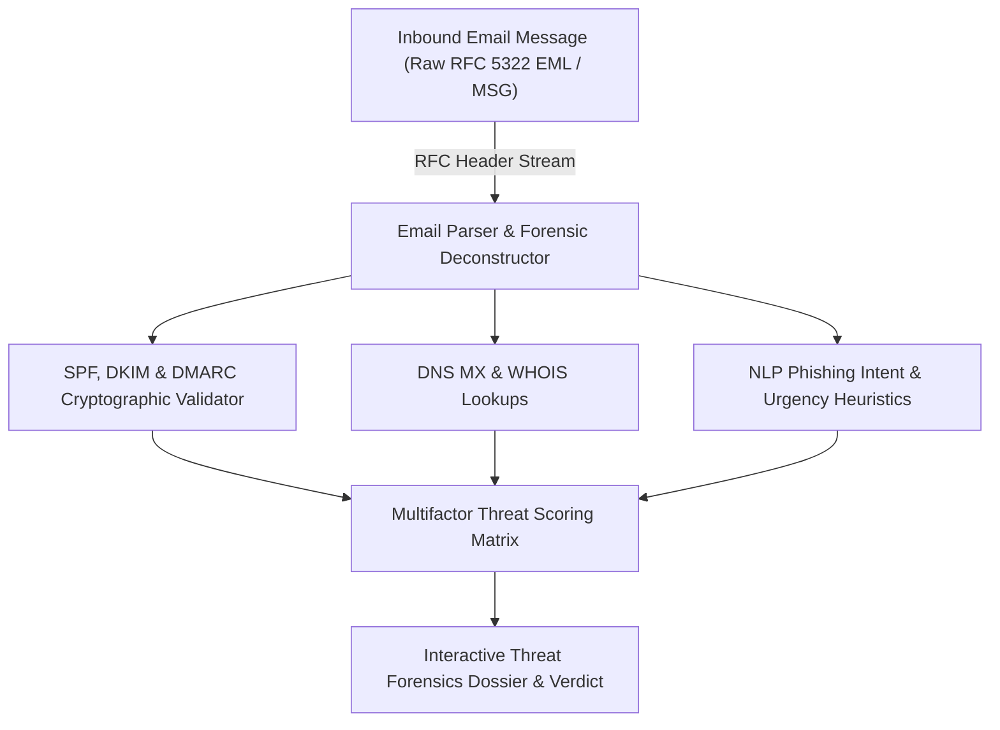

# 🛡️ Mailtrace AI — Intelligent Phishing Detection, Email Forensics & Header Threat Analyzer
### *Automated Email Security Pipeline: SPF/DKIM/DMARC Validation, NLP Threat Intent Classification & Malicious URL Heuristics*

  

  <a href="https://github.com/Tharun4743/Mailtrace-ai">📦 <b>Official GitHub Repository</b></a>
  

---

## 1. 📌 Problem Statement & Context
Business Email Compromise (BEC), spear phishing, and credential harvesting emails remain the #1 initial vector for corporate ransomware attacks. Non-technical employees cannot distinguish sophisticated spoofed headers, display-name deceptions, or obfuscated malicious links.

---

## 2. 🔍 Existing Solutions & Critical Gaps
Traditional spam filters rely primarily on static IP blocklists and keyword regexes, failing to detect zero-day phishing domains, lookalike homograph domains, or subtle emotional urgency manipulation.

---

## 3. 💡 Proposed Solution & Architectural Innovation
Mailtrace AI is an automated email forensic investigation platform. It parses raw email MIME headers, verifies cryptographic authentication (SPF, DKIM, DMARC alignment), extracts embedded links for domain age and redirect analysis, and applies NLP intent classification to detect psychological coercion (urgency, credential demands).

---

## 4. ⚙️ Technical Approach & System Architecture

### 📐 High-Level Architectural Flowchart:

| Security Pipeline | Forensic Component | Detection Logic |
| :--- | :--- | :--- |
| **MIME Parsing** | Python `email` module | Extracts Received hop IP addresses, Message-IDs, and sender headers |
| **DNS Cryptography** | `dnspython`, SPF/DKIM Verifier | Queries DNS TXT records to verify cryptographic DKIM signatures & DMARC |
| **NLP Intent Engine** | Hugging Face Transformers | Classifies social engineering intent (fake invoices, account lockout panic) |

---

## 5. 📈 Quantifiable Impact & Measurable Benefits
* 🔍 **Comprehensive Forensic Telemetry:** Flags spoofed sender domains and SPF fails within seconds.
* 📋 **Actionable Threat Dossier:** Provides security teams and end-users with color-coded risk breakdowns and safe remediation steps.
* 🛡️ **Proactive Defense:** Intercepts credential harvesters before employees click malicious links.

---

## 6. 🚀 Feasibility, Operational Viability & Scalability
* 🔬 **Technical Feasibility:** Lightweight Python microservice architecture easily deployed as an inline email proxy or browser extension.
* 🏢 **Commercial Viability:** High enterprise demand among corporate SOC (Security Operations Center) teams.

---

## 7. 👨‍💻 Engineering Author

<table border="0" itemscope itemtype="https://schema.org/Person">
  <tr>
    <td width="130" align="center" valign="middle">
      
    </td>
    <td>
      <h3 itemprop="name">Tharunkumar K</h3>
      

        <b itemprop="jobTitle">Full Stack Developer & AI Systems Engineer</b> | <b>V.S.B. Engineering College (VSBEC)</b> 
        🎓 <b>B.Tech in Information Technology</b> — <b>V.S.B. Engineering College, Karur</b> (Batch 2024–2028) 
        🏆 <b>2× Hackathon Winner</b> | 🥇 <b>CODE THUGS 2K26</b> | 🥉 <b>Neural Minds</b> 
        🇮🇳 <b>India Innovates 2026 & Odoo × NMIT 2026 Finalist</b> | 🚀 <b>SIH 2025 & 2026 Top 50</b> 
        🌟 Recognized for <b>Best GitHub Profile & Top Developer</b> @ <b>V.S.B. ENGINEERING COLLEGE</b>
      

      

        🚀 <b>Top Flagship Engineering Projects:</b> 
        • 🏛️ <b>TaskManager (VSBEC IT Vault)</b> — Institutional Task Governance & LeetCode/GitHub Sync &nbsp;&nbsp; 
        • 🧠 <b>AURA</b> — Air-Gapped Local Multimodal RAG Engine & Offline AI Assistant &nbsp; 
        • 🪖 <b>Smart Helmet IoT</b> — SIH Top 50 Dual-Unit Motorcycle Accident Prevention System &nbsp;
      

      

        &nbsp;
        &nbsp;
        &nbsp;
        &nbsp;
        
      

    </td>
  </tr>
</table>

<!-- =========================================================================
   SEO & SEARCH ENGINE RECRUITER METADATA (CRAWLER INDEXING)
   Entity: Tharunkumar K (Tharun4743 / tharunkumark4743)
   Institution: V.S.B. Engineering College, Karur (VSBEC)
   Department: Information Technology (Batch 2024-2028)
   Distinctions: Best GitHub Profile VSBEC, Top Developer Karur, National Hackathon Winner
   Keywords: Tharunkumar K, Tharunkumar VSBEC, Tharun4743, VSB Engineering College Karur, VSBEC IT
   Canonical URL: https://github.com/Tharun4743/Mailtrace-ai
========================================================================= -->
